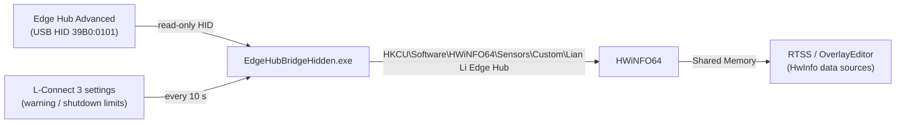

# Setting up the Lian Li connector temperature in HWiNFO64 and RTSS

End-to-end steps to get the **Lian Li Edge Hub Advanced** GPU 12V-2x6 connector temperature into HWiNFO64 and the
RTSS connector overlays on a fresh Windows machine. See [README.md](README.md) for how the bridge works and its options.



## Prerequisites

- Lian Li Edge Hub Advanced connected over USB, with the connector probe on the GPU's 12V-2x6 cable.
- **L-Connect 3** installed (it keeps working alongside the bridge; it is also where the warning/shutdown limits are set).
- **HWiNFO64** (free or Pro).
- **RivaTuner Statistics Server** (RTSS) with **OverlayEditor**, and the Volt Sleek Meters Universal (Smoke) overlay
  installed if you want to regenerate the connector overlays.
- .NET Framework 4.x (ships with Windows 10/11) — used to compile the bridge, no SDK needed.

## 1. Build and test the bridge

`bin\` is not committed, so build it after cloning:

```cmd
cd tools\edge-hub-hwinfo-bridge
build.cmd
bin\EdgeHubBridge.exe --once --no-registry
```

Expected output: the hub is found (`Connected: ...vid_39b0&pid_0101...`), the L-Connect limits (default warning 60 C,
shutdown 70 C), and readings for `GPU 1 Connector`, `Hub Ambient` and `GPU 2 Connector`. An unplugged probe shows
`n/a`. If the hub isn't found, check it shows up in L-Connect 3 and re-run with `--dump`.

## 2. Run it at logon

```powershell
powershell -ExecutionPolicy Bypass -File install-startup.ps1
```

This adds `EdgeHubBridge` under `HKCU\Software\Microsoft\Windows\CurrentVersion\Run` pointing at
`bin\EdgeHubBridgeHidden.exe` **in this checkout** and starts it now. If you move or re-clone the repo, run
`uninstall-startup.ps1` from the old location (or just re-run `install-startup.ps1` from the new one, which overwrites
the entry).

Check it is publishing:

```powershell
Get-ChildItem 'HKCU:\Software\HWiNFO64\Sensors\Custom\Lian Li Edge Hub' | ForEach-Object { Get-ItemProperty $_.PSPath | Select-Object Name, Value }
Get-Content "$env:LOCALAPPDATA\EdgeHubBridge\bridge.log" -Tail 5
```

You should see:

| Registry key | `Name` | `Value` (example) |
| --- | --- | --- |
| `Temp0` | `GPU 1 Connector` | `31.7` |
| `Temp1` | `Hub Ambient` | `32.9` |
| `Temp2` | `GPU 2 Connector` | `0` (no probe) |
| `Temp3` | `Connector Warning Limit` | `60.0` |
| `Temp4` | `Connector Shutdown Limit` | `70.0` |

## 3. Configure HWiNFO64

1. **Fully exit and restart HWiNFO64** (right-click the tray icon → Exit, then start it again). HWiNFO only discovers
   custom sensors at startup, so this is needed once after the bridge first writes the registry key.
2. In **Settings → General / User Interface**, tick **Shared Memory Support**. Without it RTSS can't read any HWiNFO
   values. (In HWiNFO64.INI this is `SensorsSM=1`. The free version turns shared memory off after 12 hours; tick it
   again or restart HWiNFO.)
3. Recommended so it runs in the background like the bridge: **Sensors-only** mode, **Minimize Main Window on
   Startup**, **Minimize Sensors on Startup**, and **Auto Start**. (This machine uses `SensorsOnly=1`,
   `MinimalizeMainWnd=1`, `MinimalizeSensors=1`, `MinimalizeSensorsClose=1`, `ShowWelcomeAndProgress=0`.)
4. Open the **Sensors** window and scroll to the bottom: a sensor group named **Lian Li Edge Hub** should list
   `GPU 1 Connector`, `Hub Ambient`, `GPU 2 Connector`, `Connector Warning Limit` and `Connector Shutdown Limit` with
   values updating every second.

## 4. Show it in RTSS

### Use the connector overlays from this repo

1. Copy the `.ovl` files and their `volt_smu_*_atlas.png` / `*_conn_smoke_atlas.png` atlases from
   `overlays\volt\sleek-meters-universal-connector\smoke\5120x1440` into
   `C:\Program Files (x86)\RivaTuner Statistics Server\Plugins\Client\Overlays`.
2. In RTSS, enable the **OverlayEditor** plugin and select the overlay (e.g.
   `volt_sleek_meters_universal_12v_conn_ring_smoke`).

The overlays already contain HwInfo data sources that match the custom sensor **by reading name**
(`Provider=HwInfo`, `SensorInst=0`, `ReadingType=1` = temperature):

| Overlay source | HWiNFO reading | Formula |
| --- | --- | --- |
| `GPU conn temp` | `GPU 1 Connector` | — |
| `Ambient temp` | `Hub Ambient` | — |
| `Conn warning` | `Connector Warning Limit` | — |
| `Conn shutdown` | `Connector Shutdown Limit` | — |
| `Conn heat` | `GPU 1 Connector` | `(x - "Conn warning") * 2 / ("Conn shutdown" - "Conn warning")` |
| `Conn pct` | `GPU 1 Connector` | `x * 100 / "Conn shutdown"` |
| `Ambient pct` | `Hub Ambient` | `x * 100 / "Conn warning"` |

If the values show as blank or `N/A`, open **OverlayEditor → Data sources**, select one of these sources and re-pick
**Lian Li Edge Hub → GPU 1 Connector** (or the matching reading) from the HWiNFO64 list.

### Add it to any other overlay

In **OverlayEditor → Edit → Data sources → Add → HWiNFO64**, pick **Lian Li Edge Hub → GPU 1 Connector**, give it a
name, and reference it in a layer like any other source (e.g. `%GPU conn temp%`).

### Regenerate the connector overlays

With Volt Sleek Meters Universal (Smoke) installed in the RTSS Overlays folder:

```powershell
powershell -ExecutionPolicy Bypass -File tools\connector-overlays\build-connector-overlays.ps1
```

Output goes to `overlays\volt\sleek-meters-universal-connector\smoke\5120x1440`; use `-SourceOvl` / `-OutDir` to change
paths.

## 5. Optional: change the limits

Set the connector warning/shutdown temperatures in **L-Connect 3** (Edge Hub settings). The bridge re-reads them every
10 seconds and the overlays' colours, ring/bar and meters follow automatically. To override them, edit the `Run`
registry value to add `--warning-temp <C>` / `--shutdown-temp <C>`.

## Troubleshooting

| Symptom | Fix |
| --- | --- |
| No **Lian Li Edge Hub** group in HWiNFO | Bridge isn't running or HWiNFO was started before it first ran — check the registry/log above, then restart HWiNFO. |
| All values `0` | Bridge stopped or the hub is disconnected — check `bridge.log`, re-run `install-startup.ps1`. |
| HWiNFO shows values, RTSS doesn't | Shared Memory Support is off (or the free version's 12 h limit hit) — re-enable it. |
| Limits stuck at 60/70 | L-Connect 3 settings not found (log says `default`); set them in L-Connect or use the override flags. |
| Remove everything | Run `uninstall-startup.ps1` (removes the logon entry, stops the bridge and deletes the custom sensor), then restart HWiNFO. |
